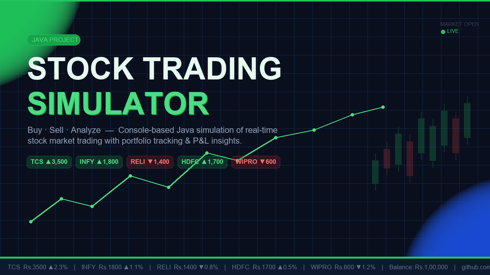

# 📈 Stock Trading Simulator

> A console-based Java application that simulates real-time stock market trading with portfolio management, transaction history, and profit/loss tracking.

---

## 🚀 Features

| Feature | Description |
|---|---|
| 📊 **Market Data** | View live stock prices for 5 major companies |
| 🛒 **Buy Stocks** | Purchase stocks with real-time balance deduction |
| 💰 **Sell Stocks** | Sell holdings with instant Profit/Loss calculation |
| 📁 **Portfolio View** | Track all holdings with total value & P&L summary |
| 🧾 **Transaction History** | Full log of every BUY/SELL transaction |
| 💳 **Balance Check** | View your available trading balance anytime |

---

## 🏦 Available Stocks

| Symbol | Company | Price |
|--------|---------|-------|
| `TCS` | TCS | Rs. 3,500 |
| `INFY` | Infosys | Rs. 1,800 |
| `RELI` | Reliance | Rs. 1,400 |
| `HDFC` | HDFC Bank | Rs. 1,700 |
| `WIPRO` | Wipro | Rs. 600 |

---

## 🛠️ Tech Stack


- **Language:** Java (JDK 8+)
- **Data Structures:** `HashMap`, `ArrayList`
- **Concepts:** OOP, Classes, Methods, Console I/O

---

## ⚙️ Getting Started

### Prerequisites
- Java JDK 8 or above
- Any terminal / command prompt

### Run the Project

```bash
# Clone the repository
git clone https://github.com/hey-vrushrab/CodeAlpha_Stock-Trading.git

# Navigate to folder
cd CodeAlpha_Stock-Trading

# Compile
javac StockTradingPlatform.java

# Run
java StockTradingPlatform
```

---

## 🎮 How to Use

```
=================================
       STOCK TRADING PLATFORM
=================================
Enter User Name: Vrushrab

1. Display Market Data
2. Buy Stocks
3. Sell Stocks
4. View Portfolio
5. Transaction History
6. Check Balance
7. Exit
```

1. **Start** → Enter your name
2. **Option 1** → View all stock prices
3. **Option 2** → Buy: enter symbol (e.g. `TCS`) + quantity
4. **Option 3** → Sell: enter symbol + quantity → see Profit/Loss
5. **Option 4** → View full portfolio summary
6. **Option 5** → View all past transactions

---

## 📂 Project Structure

```
CodeAlpha_Stock-Trading/
│
├── StockTradingPlatform.java   # Main application file
├── banner.png                  # Project banner (16:9)
└── README.md                   # Project documentation
```

---

## 💡 Key Concepts Used

- **OOP Classes:** `Stock`, `Transaction`, `User`, `StockTradingPlatform`
- **Average Cost Tracking:** Accurate P&L using weighted average buy price
- **Collections:** `HashMap` for portfolio & investments, `ArrayList` for history
- **Scanner:** Console-based interactive menu

---

## 📃 License

This project is built as part of the **CodeAlpha Java Internship** program.

---

<div align="center">
  <b>Made with ☕ Java by <a href="https://github.com/hey-vrushrab">Vrushrab</a></b>
</div>
